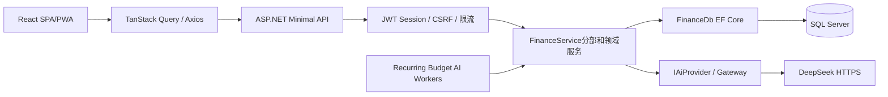

# 架构及业务调用链

生成日期：2026-10-31（Asia/Shanghai）

分支：`main`；Commit：`91bbbdff824bbded9f0e81da29cee6c3df6d19ef`。包含原有未提交实现，HEAD不足以复现。

目的：架构及业务调用链。

## 已实现

生产可由后端wwwroot托管SPA；Docker Compose与反向代理部署。未确认Redis或外部消息队列；内存缓存与数据库任务不等于独立队列服务。

- 交易：TransactionsPage/TransactionCreatePage→src/api/finance→FinanceEndpoints→FinanceService.Write→哈希/锁/事务→Transaction/Entry→响应。余额见TransactionRunningBalances。
- 导入：ImportPage→映射/清洗/重复复核→Import*Service→统一写入/执行历史→恢复与冲销。重复身份不能只用同日同额。
- 对账：ReconciliationPage→SmartReconciliation/Statement接口→规则和任务步骤→StatementRecord/Link→确认或取消；不可将差额自动记收入。
- 投资：InvestmentsPage→InvestmentService/PerformanceService→InvestmentMath→现金流/估值；不收敛不能返回虚假0收益。
- AI：GlobalCopilot/AiAgentPage→AiEndpoints→Privacy/Context→受控工具→领域查询→DeepSeek→结构化校验与证据；写操作另行预览授权。
- 人生模拟：LifeSimulatorPage→Life*引擎→快照/StoredDocument；不写正式账务。

FinanceService.Write是跨表事务边界之一，其他服务需逐接口核对。Database:SnapshotReads启用时GET使用快照事务，要求数据库已启用快照隔离。缓存必须隔离用户、数据库、参数并处理撤权。

证据：[backend/src/PersonalFinance.Api/Program.cs](<../../backend/src/PersonalFinance.Api/Program.cs>)、[backend/src/PersonalFinance.Api/Application/FinanceService.cs](<../../backend/src/PersonalFinance.Api/Application/FinanceService.cs>)、[backend/src/PersonalFinance.Api/Infrastructure/FinanceDb.cs](<../../backend/src/PersonalFinance.Api/Infrastructure/FinanceDb.cs>)。

## 设计及未来

人生模拟器完整向导/后台恢复、移动SSD运行时打包、跨机密钥迁移没有完成验收证据，见10。历史设计不作为已实现架构。

## 未验证事项

本次未逐业务端到端验收；数据库实态、生产、外部AI及历史报告适用性见 [验收记录](14-HANDOVER-VALIDATION.md)。
