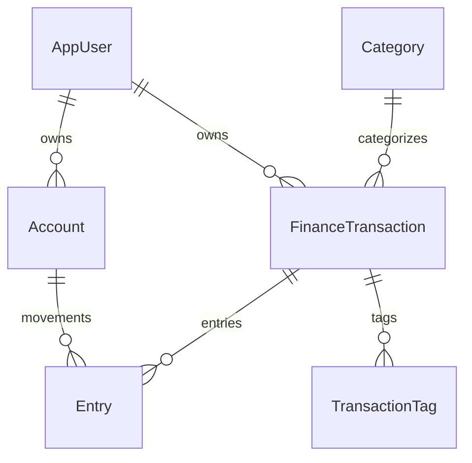

# 数据库交接

生成日期：2026-10-31（Asia/Shanghai）

分支：`main`；Commit：`91bbbdff824bbded9f0e81da29cee6c3df6d19ef`。包含原有未提交实现，HEAD不足以复现。

目的：数据库交接。

当前为SQL Server + EF Core SQL Server 10.0.12，连接名ConnectionStrings__Finance，finance schema。服务器版本本轮实测为 SQL Server 2025 Express 17.0.1050.2（默认实例 `Server=.`，Windows 集成认证）；隔离回归用 LocalDB 17.0.4025.3 独立实例。不是SQLite文件数据库。

完整字段、SQL类型、主键、索引及关系见 [模型参考](DATABASE-SCHEMA-REFERENCE.md)。本轮实测：源码迁移 93 个，隔离库 93/93 应用、表 139 张（finance 138 + `dbo.__EFMigrationsHistory`），`has-pending-model-changes` 无变更；真实库 `PersonalFinanceWeb` 只读迁移历史为 46/93（未应用 47，末条已应用 `20261013120504_AiRequestConsentAudit`，无源码中不存在的迁移）。**真实库数据量、索引使用率、备份副本内容本轮仍未读取；当前源码不能直接连真实库运行。** 源码模型不代表真实库已应用全部迁移。

当前FinanceTransaction有Amount、AccountId、ToAccountId和Entries；根README中“凭证头不存金额”的旧Signed Amount设计不可直接套用。根sql/与Build.sql是旧方案，不能在应用库执行。

这是领域关系概览，不保证所有UserId都有物理外键；物理约束看快照。

Program仅在显式--initialize-db时MigrateAsync并Bootstrap写种子。普通启动不自动迁移，但有后台任务，不能当只读检查。库名前缀检查不等于操作授权；且该检查只要求 InitialCatalog 以 `PersonalFinanceWeb` 开头（会放行 `PersonalFinanceWeb_Cloud`），严禁对疑似正式库使用 `--initialize-db`。已有库先核对__EFMigrationsHistory，不能重建。隔离回归建议用独立 LocalDB 实例 + 随机 RestoreCheck 库（步骤见 [16-CANDIDATE-VERIFICATION-20261031.md](16-CANDIDATE-VERIFICATION-20261031.md)）。

FinanceService.Write使用ReadCommitted事务、用户sp_getapplock，部分路径附加协作锁；幂等键绑定请求哈希，Version冲突409。不能推断所有跨表服务都自动受同一事务保护，改具体接口时核查Write入口及BeginTransaction。

FinanceService.Money最多两位小数，M输出两位；Fuel前段显式配置数量/单价18,3、里程18,1，但末尾通用循环再次设置decimal为28,4（名称含Rate为28,8），存在配置覆盖顺序。本轮已实测澄清：循环确实覆盖前段声明，实际生效为28,4（更宽、不截断）；隔离库抽查 `finance.FuelRecord`（Amount/Discount/EnteredUnitPrice/Litres/Odometer/OriginalAmount/PointsRedemption/PostedUnitPrice）、`InvestmentTrade`（Amount/Commission/OtherFee/Tax=28,4；Price/Quantity=28,8）、`AiUsageRecord`（20,10）与 `FinanceDbModelSnapshot.cs` 的 143 处 HasPrecision 一致，且无挂起迁移，因此**未改模型或迁移**。若今后要收紧精度，须先备份、在隔离恢复库验证、经授权才可改模型并新增迁移。专用汇率和数量精度不可套用通用金额规则。DateTimeOffset与DateOnly混合用于时点和业务日期，用户默认Asia/Shanghai；跨时区变更必须测试月份边界。

云端 `deploy/scripts/backup.sh` / `restore-from-bak.sh` 已随 2026-11-14 完全本地化删除；本地备份流程见根目录 `备份并升级本地数据库.bat`，等价步骤为 `BACKUP … WITH INIT, CHECKSUM` → `RESTORE VERIFYONLY`（2026-11-14 实跑：99MB 备份 VERIFYONLY 通过）。VERIFYONLY 不代替独立完整恢复；未枚举真实副本，不清理任何库或备份。

移动SSD不能复制运行中的MDF/LDF作为安全便携方案，多机不得并发使用同一文件。代码与财务数据分开交接，附件可能在数据库二进制列中；.keys及DPAPI保护密钥需要安全迁移。

## 迁移顺序（源码文件名）

[backend/src/PersonalFinance.Api/Infrastructure/Migrations/20261007174605_InitialFinance.cs](<../../backend/src/PersonalFinance.Api/Infrastructure/Migrations/20261007174605_InitialFinance.cs>)

[backend/src/PersonalFinance.Api/Infrastructure/Migrations/20261007175657_ImportFingerprintConstraint.cs](<../../backend/src/PersonalFinance.Api/Infrastructure/Migrations/20261007175657_ImportFingerprintConstraint.cs>)

[backend/src/PersonalFinance.Api/Infrastructure/Migrations/20261007180556_FinancialValueConstraints.cs](<../../backend/src/PersonalFinance.Api/Infrastructure/Migrations/20261007180556_FinancialValueConstraints.cs>)

[backend/src/PersonalFinance.Api/Infrastructure/Migrations/20261008135953_OperationRecoveryAudit.cs](<../../backend/src/PersonalFinance.Api/Infrastructure/Migrations/20261008135953_OperationRecoveryAudit.cs>)

[backend/src/PersonalFinance.Api/Infrastructure/Migrations/20261008145802_ImportExecutionRecovery.cs](<../../backend/src/PersonalFinance.Api/Infrastructure/Migrations/20261008145802_ImportExecutionRecovery.cs>)

[backend/src/PersonalFinance.Api/Infrastructure/Migrations/20261008150403_ExternalTransactionReferenceLength.cs](<../../backend/src/PersonalFinance.Api/Infrastructure/Migrations/20261008150403_ExternalTransactionReferenceLength.cs>)

[backend/src/PersonalFinance.Api/Infrastructure/Migrations/20261008153120_ImportIdentityReview.cs](<../../backend/src/PersonalFinance.Api/Infrastructure/Migrations/20261008153120_ImportIdentityReview.cs>)

[backend/src/PersonalFinance.Api/Infrastructure/Migrations/20261009105117_RecurringPlanning.cs](<../../backend/src/PersonalFinance.Api/Infrastructure/Migrations/20261009105117_RecurringPlanning.cs>)

[backend/src/PersonalFinance.Api/Infrastructure/Migrations/20261009110610_SubscriptionAutomation.cs](<../../backend/src/PersonalFinance.Api/Infrastructure/Migrations/20261009110610_SubscriptionAutomation.cs>)

[backend/src/PersonalFinance.Api/Infrastructure/Migrations/20261009111749_RecurringMetadata.cs](<../../backend/src/PersonalFinance.Api/Infrastructure/Migrations/20261009111749_RecurringMetadata.cs>)

[backend/src/PersonalFinance.Api/Infrastructure/Migrations/20261009131635_TransactionBatchReview.cs](<../../backend/src/PersonalFinance.Api/Infrastructure/Migrations/20261009131635_TransactionBatchReview.cs>)

[backend/src/PersonalFinance.Api/Infrastructure/Migrations/20261009153729_FinancialPlanning.cs](<../../backend/src/PersonalFinance.Api/Infrastructure/Migrations/20261009153729_FinancialPlanning.cs>)

[backend/src/PersonalFinance.Api/Infrastructure/Migrations/20261009154933_PlanningEnvelopeUniqueness.cs](<../../backend/src/PersonalFinance.Api/Infrastructure/Migrations/20261009154933_PlanningEnvelopeUniqueness.cs>)

[backend/src/PersonalFinance.Api/Infrastructure/Migrations/20261009210835_FinancialAnalysisAttributes.cs](<../../backend/src/PersonalFinance.Api/Infrastructure/Migrations/20261009210835_FinancialAnalysisAttributes.cs>)

[backend/src/PersonalFinance.Api/Infrastructure/Migrations/20261010103907_DebtRepaymentPlanning.cs](<../../backend/src/PersonalFinance.Api/Infrastructure/Migrations/20261010103907_DebtRepaymentPlanning.cs>)

[backend/src/PersonalFinance.Api/Infrastructure/Migrations/20261010111317_ScenarioCalculationSnapshots.cs](<../../backend/src/PersonalFinance.Api/Infrastructure/Migrations/20261010111317_ScenarioCalculationSnapshots.cs>)

[backend/src/PersonalFinance.Api/Infrastructure/Migrations/20261010111616_DebtPaymentReconciliation.cs](<../../backend/src/PersonalFinance.Api/Infrastructure/Migrations/20261010111616_DebtPaymentReconciliation.cs>)

[backend/src/PersonalFinance.Api/Infrastructure/Migrations/20261010114305_DebtPrincipalBaseline.cs](<../../backend/src/PersonalFinance.Api/Infrastructure/Migrations/20261010114305_DebtPrincipalBaseline.cs>)

[backend/src/PersonalFinance.Api/Infrastructure/Migrations/20261010123927_InvestmentManagement.cs](<../../backend/src/PersonalFinance.Api/Infrastructure/Migrations/20261010123927_InvestmentManagement.cs>)

[backend/src/PersonalFinance.Api/Infrastructure/Migrations/20261010124750_AssetManagementAndCustomReports.cs](<../../backend/src/PersonalFinance.Api/Infrastructure/Migrations/20261010124750_AssetManagementAndCustomReports.cs>)

[backend/src/PersonalFinance.Api/Infrastructure/Migrations/20261010132657_ControlledPositionAdjustments.cs](<../../backend/src/PersonalFinance.Api/Infrastructure/Migrations/20261010132657_ControlledPositionAdjustments.cs>)

[backend/src/PersonalFinance.Api/Infrastructure/Migrations/20261010162337_TransactionDirectPromotions.cs](<../../backend/src/PersonalFinance.Api/Infrastructure/Migrations/20261010162337_TransactionDirectPromotions.cs>)

[backend/src/PersonalFinance.Api/Infrastructure/Migrations/20261010162613_PromotionInventoryCashbacks.cs](<../../backend/src/PersonalFinance.Api/Infrastructure/Migrations/20261010162613_PromotionInventoryCashbacks.cs>)

[backend/src/PersonalFinance.Api/Infrastructure/Migrations/20261010163015_PromotionRefundReturns.cs](<../../backend/src/PersonalFinance.Api/Infrastructure/Migrations/20261010163015_PromotionRefundReturns.cs>)

[backend/src/PersonalFinance.Api/Infrastructure/Migrations/20261010163742_SubsidizedTransferDraft.cs](<../../backend/src/PersonalFinance.Api/Infrastructure/Migrations/20261010163742_SubsidizedTransferDraft.cs>)

[backend/src/PersonalFinance.Api/Infrastructure/Migrations/20261010170205_PromotionRatesRecoveriesAndConfirmation.cs](<../../backend/src/PersonalFinance.Api/Infrastructure/Migrations/20261010170205_PromotionRatesRecoveriesAndConfirmation.cs>)

[backend/src/PersonalFinance.Api/Infrastructure/Migrations/20261010175525_StageGIncrementalDomains.cs](<../../backend/src/PersonalFinance.Api/Infrastructure/Migrations/20261010175525_StageGIncrementalDomains.cs>)

[backend/src/PersonalFinance.Api/Infrastructure/Migrations/20261010180005_StageGQuantityPrecision.cs](<../../backend/src/PersonalFinance.Api/Infrastructure/Migrations/20261010180005_StageGQuantityPrecision.cs>)

[backend/src/PersonalFinance.Api/Infrastructure/Migrations/20261010181018_StageGAdvanceAdjustments.cs](<../../backend/src/PersonalFinance.Api/Infrastructure/Migrations/20261010181018_StageGAdvanceAdjustments.cs>)

[backend/src/PersonalFinance.Api/Infrastructure/Migrations/20261010213327_StageGAdvanceGroups.cs](<../../backend/src/PersonalFinance.Api/Infrastructure/Migrations/20261010213327_StageGAdvanceGroups.cs>)

[backend/src/PersonalFinance.Api/Infrastructure/Migrations/20261010213819_StageGSettlementCorrections.cs](<../../backend/src/PersonalFinance.Api/Infrastructure/Migrations/20261010213819_StageGSettlementCorrections.cs>)

[backend/src/PersonalFinance.Api/Infrastructure/Migrations/20261010214535_StageGAuthorizedAdvanceAmount.cs](<../../backend/src/PersonalFinance.Api/Infrastructure/Migrations/20261010214535_StageGAuthorizedAdvanceAmount.cs>)

[backend/src/PersonalFinance.Api/Infrastructure/Migrations/20261011103824_StageGAdvancePurchasePlans.cs](<../../backend/src/PersonalFinance.Api/Infrastructure/Migrations/20261011103824_StageGAdvancePurchasePlans.cs>)

[backend/src/PersonalFinance.Api/Infrastructure/Migrations/20261011104045_StageGContributionAssociations.cs](<../../backend/src/PersonalFinance.Api/Infrastructure/Migrations/20261011104045_StageGContributionAssociations.cs>)

[backend/src/PersonalFinance.Api/Infrastructure/Migrations/20261011105116_StageGProvenanceAndRoles.cs](<../../backend/src/PersonalFinance.Api/Infrastructure/Migrations/20261011105116_StageGProvenanceAndRoles.cs>)

[backend/src/PersonalFinance.Api/Infrastructure/Migrations/20261011110427_StageGExternalFactsAndPriceIdentity.cs](<../../backend/src/PersonalFinance.Api/Infrastructure/Migrations/20261011110427_StageGExternalFactsAndPriceIdentity.cs>)

[backend/src/PersonalFinance.Api/Infrastructure/Migrations/20261011160539_AccountManagementV2.cs](<../../backend/src/PersonalFinance.Api/Infrastructure/Migrations/20261011160539_AccountManagementV2.cs>)

[backend/src/PersonalFinance.Api/Infrastructure/Migrations/20261011162008_AccountFeeClassification.cs](<../../backend/src/PersonalFinance.Api/Infrastructure/Migrations/20261011162008_AccountFeeClassification.cs>)

[backend/src/PersonalFinance.Api/Infrastructure/Migrations/20261011172702_PersonalInformationCenter.cs](<../../backend/src/PersonalFinance.Api/Infrastructure/Migrations/20261011172702_PersonalInformationCenter.cs>)

[backend/src/PersonalFinance.Api/Infrastructure/Migrations/20261012122849_AiFoundation.cs](<../../backend/src/PersonalFinance.Api/Infrastructure/Migrations/20261012122849_AiFoundation.cs>)

[backend/src/PersonalFinance.Api/Infrastructure/Migrations/20261013104647_AiScopeHistoryAudit.cs](<../../backend/src/PersonalFinance.Api/Infrastructure/Migrations/20261013104647_AiScopeHistoryAudit.cs>)

[backend/src/PersonalFinance.Api/Infrastructure/Migrations/20261013110014_AiAtomicQuotaReservations.cs](<../../backend/src/PersonalFinance.Api/Infrastructure/Migrations/20261013110014_AiAtomicQuotaReservations.cs>)

[backend/src/PersonalFinance.Api/Infrastructure/Migrations/20261013110502_AiConfigurationIdentifiers.cs](<../../backend/src/PersonalFinance.Api/Infrastructure/Migrations/20261013110502_AiConfigurationIdentifiers.cs>)

[backend/src/PersonalFinance.Api/Infrastructure/Migrations/20261013111429_AiPersistentTransactionDrafts.cs](<../../backend/src/PersonalFinance.Api/Infrastructure/Migrations/20261013111429_AiPersistentTransactionDrafts.cs>)

[backend/src/PersonalFinance.Api/Infrastructure/Migrations/20261013115825_AiConsentVersion.cs](<../../backend/src/PersonalFinance.Api/Infrastructure/Migrations/20261013115825_AiConsentVersion.cs>)

[backend/src/PersonalFinance.Api/Infrastructure/Migrations/20261013120504_AiRequestConsentAudit.cs](<../../backend/src/PersonalFinance.Api/Infrastructure/Migrations/20261013120504_AiRequestConsentAudit.cs>)

[backend/src/PersonalFinance.Api/Infrastructure/Migrations/20261014110753_AiCenterReports.cs](<../../backend/src/PersonalFinance.Api/Infrastructure/Migrations/20261014110753_AiCenterReports.cs>)

[backend/src/PersonalFinance.Api/Infrastructure/Migrations/20261016103815_AiAutonomousAgent.cs](<../../backend/src/PersonalFinance.Api/Infrastructure/Migrations/20261016103815_AiAutonomousAgent.cs>)

[backend/src/PersonalFinance.Api/Infrastructure/Migrations/20261016105443_AiAgentProviderCallIds.cs](<../../backend/src/PersonalFinance.Api/Infrastructure/Migrations/20261016105443_AiAgentProviderCallIds.cs>)

[backend/src/PersonalFinance.Api/Infrastructure/Migrations/20261016155812_ExpenseProductName.cs](<../../backend/src/PersonalFinance.Api/Infrastructure/Migrations/20261016155812_ExpenseProductName.cs>)

[backend/src/PersonalFinance.Api/Infrastructure/Migrations/20261016164922_TransferPurpose.cs](<../../backend/src/PersonalFinance.Api/Infrastructure/Migrations/20261016164922_TransferPurpose.cs>)

[backend/src/PersonalFinance.Api/Infrastructure/Migrations/20261017122054_AdministrationAndSupport.cs](<../../backend/src/PersonalFinance.Api/Infrastructure/Migrations/20261017122054_AdministrationAndSupport.cs>)

[backend/src/PersonalFinance.Api/Infrastructure/Migrations/20261017130458_PayrollSocialBenefitsCenter.cs](<../../backend/src/PersonalFinance.Api/Infrastructure/Migrations/20261017130458_PayrollSocialBenefitsCenter.cs>)

[backend/src/PersonalFinance.Api/Infrastructure/Migrations/20261017134600_PayrollLegacyAttributes.cs](<../../backend/src/PersonalFinance.Api/Infrastructure/Migrations/20261017134600_PayrollLegacyAttributes.cs>)

[backend/src/PersonalFinance.Api/Infrastructure/Migrations/20261017173713_InvitationAccess.cs](<../../backend/src/PersonalFinance.Api/Infrastructure/Migrations/20261017173713_InvitationAccess.cs>)

[backend/src/PersonalFinance.Api/Infrastructure/Migrations/20261018105029_ExpandedCurrencyCatalog.cs](<../../backend/src/PersonalFinance.Api/Infrastructure/Migrations/20261018105029_ExpandedCurrencyCatalog.cs>)

[backend/src/PersonalFinance.Api/Infrastructure/Migrations/20261019103411_ImportCleaningAndMerchantMaster412.cs](<../../backend/src/PersonalFinance.Api/Infrastructure/Migrations/20261019103411_ImportCleaningAndMerchantMaster412.cs>)

[backend/src/PersonalFinance.Api/Infrastructure/Migrations/20261019113059_TimeAssetsManagement.cs](<../../backend/src/PersonalFinance.Api/Infrastructure/Migrations/20261019113059_TimeAssetsManagement.cs>)

[backend/src/PersonalFinance.Api/Infrastructure/Migrations/20261019124505_FuelTracking.cs](<../../backend/src/PersonalFinance.Api/Infrastructure/Migrations/20261019124505_FuelTracking.cs>)

[backend/src/PersonalFinance.Api/Infrastructure/Migrations/20261020114548_AccountBankBranch.cs](<../../backend/src/PersonalFinance.Api/Infrastructure/Migrations/20261020114548_AccountBankBranch.cs>)

[backend/src/PersonalFinance.Api/Infrastructure/Migrations/20261020154641_FuelOptionalOdometer.cs](<../../backend/src/PersonalFinance.Api/Infrastructure/Migrations/20261020154641_FuelOptionalOdometer.cs>)

[backend/src/PersonalFinance.Api/Infrastructure/Migrations/20261020155817_FuelQuantityPrice.cs](<../../backend/src/PersonalFinance.Api/Infrastructure/Migrations/20261020155817_FuelQuantityPrice.cs>)

[backend/src/PersonalFinance.Api/Infrastructure/Migrations/20261021102507_FinancialMemories.cs](<../../backend/src/PersonalFinance.Api/Infrastructure/Migrations/20261021102507_FinancialMemories.cs>)

[backend/src/PersonalFinance.Api/Infrastructure/Migrations/20261022103647_PhysicalAssetCenter.cs](<../../backend/src/PersonalFinance.Api/Infrastructure/Migrations/20261022103647_PhysicalAssetCenter.cs>)

[backend/src/PersonalFinance.Api/Infrastructure/Migrations/20261022161514_TransactionWorkspace.cs](<../../backend/src/PersonalFinance.Api/Infrastructure/Migrations/20261022161514_TransactionWorkspace.cs>)

[backend/src/PersonalFinance.Api/Infrastructure/Migrations/20261022174635_SharedFinanceCenters.cs](<../../backend/src/PersonalFinance.Api/Infrastructure/Migrations/20261022174635_SharedFinanceCenters.cs>)

[backend/src/PersonalFinance.Api/Infrastructure/Migrations/20261022175426_SharedFinanceSplitInputs.cs](<../../backend/src/PersonalFinance.Api/Infrastructure/Migrations/20261022175426_SharedFinanceSplitInputs.cs>)

[backend/src/PersonalFinance.Api/Infrastructure/Migrations/20261024113738_AccountFullCardNumber.cs](<../../backend/src/PersonalFinance.Api/Infrastructure/Migrations/20261024113738_AccountFullCardNumber.cs>)

[backend/src/PersonalFinance.Api/Infrastructure/Migrations/20261025173437_MillionLedgerQueryIndexes.cs](<../../backend/src/PersonalFinance.Api/Infrastructure/Migrations/20261025173437_MillionLedgerQueryIndexes.cs>)

[backend/src/PersonalFinance.Api/Infrastructure/Migrations/20261025174433_LedgerEntryCoveringIndex.cs](<../../backend/src/PersonalFinance.Api/Infrastructure/Migrations/20261025174433_LedgerEntryCoveringIndex.cs>)

[backend/src/PersonalFinance.Api/Infrastructure/Migrations/20261025175328_LedgerTransactionProjectionIndex.cs](<../../backend/src/PersonalFinance.Api/Infrastructure/Migrations/20261025175328_LedgerTransactionProjectionIndex.cs>)

[backend/src/PersonalFinance.Api/Infrastructure/Migrations/20261025182552_RefundOriginLookupIndex.cs](<../../backend/src/PersonalFinance.Api/Infrastructure/Migrations/20261025182552_RefundOriginLookupIndex.cs>)

[backend/src/PersonalFinance.Api/Infrastructure/Migrations/20261026112139_ComplexTransactionQueryIndexes.cs](<../../backend/src/PersonalFinance.Api/Infrastructure/Migrations/20261026112139_ComplexTransactionQueryIndexes.cs>)

[backend/src/PersonalFinance.Api/Infrastructure/Migrations/20261026144759_SmartReconciliationEvidence.cs](<../../backend/src/PersonalFinance.Api/Infrastructure/Migrations/20261026144759_SmartReconciliationEvidence.cs>)

[backend/src/PersonalFinance.Api/Infrastructure/Migrations/20261026145123_SmartReconciliationTasks.cs](<../../backend/src/PersonalFinance.Api/Infrastructure/Migrations/20261026145123_SmartReconciliationTasks.cs>)

[backend/src/PersonalFinance.Api/Infrastructure/Migrations/20261026150332_StatementResolutionHistory.cs](<../../backend/src/PersonalFinance.Api/Infrastructure/Migrations/20261026150332_StatementResolutionHistory.cs>)

[backend/src/PersonalFinance.Api/Infrastructure/Migrations/20261026150720_StatementAllocationRelations.cs](<../../backend/src/PersonalFinance.Api/Infrastructure/Migrations/20261026150720_StatementAllocationRelations.cs>)

[backend/src/PersonalFinance.Api/Infrastructure/Migrations/20261026163550_SmartReconciliationProvenanceAndTaskHistory.cs](<../../backend/src/PersonalFinance.Api/Infrastructure/Migrations/20261026163550_SmartReconciliationProvenanceAndTaskHistory.cs>)

[backend/src/PersonalFinance.Api/Infrastructure/Migrations/20261026165353_SmartReconciliationConfirmationMode.cs](<../../backend/src/PersonalFinance.Api/Infrastructure/Migrations/20261026165353_SmartReconciliationConfirmationMode.cs>)

[backend/src/PersonalFinance.Api/Infrastructure/Migrations/20261026172301_SmartReconciliationHistoryIndex.cs](<../../backend/src/PersonalFinance.Api/Infrastructure/Migrations/20261026172301_SmartReconciliationHistoryIndex.cs>)

[backend/src/PersonalFinance.Api/Infrastructure/Migrations/20261026184313_SmartReconciliationTransactionLookupIndex.cs](<../../backend/src/PersonalFinance.Api/Infrastructure/Migrations/20261026184313_SmartReconciliationTransactionLookupIndex.cs>)

[backend/src/PersonalFinance.Api/Infrastructure/Migrations/20261026213759_StatementRuleExpectedAmount.cs](<../../backend/src/PersonalFinance.Api/Infrastructure/Migrations/20261026213759_StatementRuleExpectedAmount.cs>)

[backend/src/PersonalFinance.Api/Infrastructure/Migrations/20261027162830_AiPersonalReadAccess.cs](<../../backend/src/PersonalFinance.Api/Infrastructure/Migrations/20261027162830_AiPersonalReadAccess.cs>)

[backend/src/PersonalFinance.Api/Infrastructure/Migrations/20261027163854_AiStructuredReportSnapshots.cs](<../../backend/src/PersonalFinance.Api/Infrastructure/Migrations/20261027163854_AiStructuredReportSnapshots.cs>)

[backend/src/PersonalFinance.Api/Infrastructure/Migrations/20261028102517_AiUnifiedFinancialConsent.cs](<../../backend/src/PersonalFinance.Api/Infrastructure/Migrations/20261028102517_AiUnifiedFinancialConsent.cs>)

[backend/src/PersonalFinance.Api/Infrastructure/Migrations/20261028213038_SpendingApprovalDocumentLookup.cs](<../../backend/src/PersonalFinance.Api/Infrastructure/Migrations/20261028213038_SpendingApprovalDocumentLookup.cs>)

[backend/src/PersonalFinance.Api/Infrastructure/Migrations/20261030105230_FuelTankStatus.cs](<../../backend/src/PersonalFinance.Api/Infrastructure/Migrations/20261030105230_FuelTankStatus.cs>)

[backend/src/PersonalFinance.Api/Infrastructure/Migrations/20261030110536_FuelGrade.cs](<../../backend/src/PersonalFinance.Api/Infrastructure/Migrations/20261030110536_FuelGrade.cs>)

[backend/src/PersonalFinance.Api/Infrastructure/Migrations/20261030112250_FuelVehicleProfile.cs](<../../backend/src/PersonalFinance.Api/Infrastructure/Migrations/20261030112250_FuelVehicleProfile.cs>)

[backend/src/PersonalFinance.Api/Infrastructure/Migrations/20261030120818_FuelRecordTrash.cs](<../../backend/src/PersonalFinance.Api/Infrastructure/Migrations/20261030120818_FuelRecordTrash.cs>)

[backend/src/PersonalFinance.Api/Infrastructure/Migrations/20261030153429_FuelReceiptFacts.cs](<../../backend/src/PersonalFinance.Api/Infrastructure/Migrations/20261030153429_FuelReceiptFacts.cs>)

[backend/src/PersonalFinance.Api/Infrastructure/Migrations/20261030154723_FuelEventChronology.cs](<../../backend/src/PersonalFinance.Api/Infrastructure/Migrations/20261030154723_FuelEventChronology.cs>)

[backend/src/PersonalFinance.Api/Infrastructure/Migrations/20261030155832_FuelQueryIndexes.cs](<../../backend/src/PersonalFinance.Api/Infrastructure/Migrations/20261030155832_FuelQueryIndexes.cs>)

## 未验证事项

本次未逐业务端到端验收；数据库实态、生产、外部AI及历史报告适用性见 [验收记录](14-HANDOVER-VALIDATION.md)。
