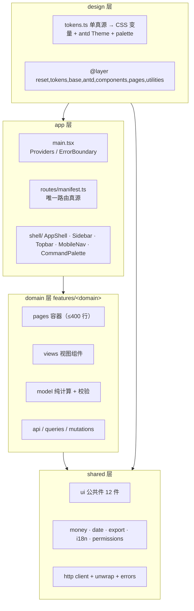

# 个人记账 · 前端页面重构方案（允许完全重构）

- 文档日期：2026-11-03（Asia/Shanghai）
- 性质：**只读分析产出**。本次未修改任何源码、未运行构建/测试/发布/部署。
- 事实来源：`frontend/src` 全量静态读取、`frontend/dist` 实测清单、既有审计 `代码审查报告-20261028.md`、`docs/Apple-首页与仪表盘重构-开发与验收报告-20261031.md`、`docs/ai-handover/09`、`10`、`16`。
- 适用对象：数据所有者 / 后续接手的前端负责人。

---

## 0. 一页结论

**现状判断**：这不是"几个页面要优化"，而是一个 11.5 万行、65 个页面、约 100 条路由的 React 19 SPA 出现了**四层结构性债务**——壳层、设计系统、数据层、公共组件各自演化出多套并行实现，缺少单一真源。功能本身基本可用，债务集中在"同一件事有 2–5 种写法"。

**三个关键事实**（决定方案走向）：

| 事实 | 数据 |
|---|---|
| 可机械迁移的代码不多 | 页面+域共 77,225 行中，**29.2% 可机械迁移**、**68.6% 需重写或拆域**、2.2% 可合并下线 |
| 真正的成本不在页面 | 缺 8 个公共件（金额、隐私掩码、导出、期间、危险确认、权限、数据工作区、版本化写入），它们的重复实现散布在 38–45 个文件里 |
| 一次性重写风险高 | 606 个单测、20+ 条资金一致性行为、幂等提交日志 + 401 单飞刷新状态机、`release-integrity` 对 `frontend/src` 全量指纹、`releases.json` 与发布强耦合 |

**推荐方案（B）**：**结构上完全重构，交付上分域渐进。**
新外壳、新路由模型、新数据层、新设计系统、新公共件**一次重写到位**；页面按业务域**分 3 波迁移**，每波可发布、可回滚、可并行。日历 **14–18 周 / 3 人**（约 30–40 人周），不建议"停 4 个月全量重写"（Option C，见 §6）。

**三条铁律**：
1. **不动后端与 API 契约**，只重构前端表达层。
2. **每个阶段结束时系统可构建、可测试、可发布、可回滚**。
3. **先公共件、后页面**；先低风险域、后资金核心域（QuickEntry / Accounts / Reconciliation 最后迁）。

---

## 1. 现状基线

### 1.1 规模（实测）

| 目录 | 文件 | 行数 | 说明 |
|---|---:|---:|---|
| `pages/` | 65 | 36,840 | 扁平存放，无子目录 |
| `features/` | 209 | 40,385 | 21 个业务域 |
| `components/` | 33 | 3,459 | 公共组件 |
| `api/` | 22 | 3,875 | 127 个端点封装 |
| `design/` | 17 | 7,035 | 其中 CSS 约 7,000 行 |
| `i18n/` | 7 | 4,340 | `en.json` 3,719 行 |
| `mocks/` | 15 | 4,881 | MSW 86 个 handler |
| `tests/` | 106 | 13,055 | 103 个测试文件 / 606 用例 |
| `types/` | 1 | 666 | 65 个导出，单文件 |
| 其他（routes/layouts/stores/hooks/utils/constants/data） | 15 | 4,506 | |
| **合计** | **约 500** | **约 115,000** | TS/TSX 约 10.5 万行，CSS 10,226 行 |

技术栈：React 19.1 · TS 5.9（strict）· Vite 7 · antd 5.27 · TanStack Query 5 · zustand 5 · axios · echarts 6 · dayjs · react-router 7（`createBrowserRouter`）· MSW · Vitest · Playwright。无 Tailwind、无 CSS-in-JS、无 codegen/OpenAPI。

### 1.2 结构地图

```
src/
├─ main.tsx            # 130 行：主题/暗色/视觉视口/PWA/Mock/QueryClient 全在这里
├─ routes/index.tsx    # 303 行、70 处 path + 4 处展开 ≈ 100 条路由（全部 lazy）
├─ layouts/AppLayout   # 487 行，10 类职责（见 §2.1）
├─ design/             # 17 个文件 7,035 行：tokens.css / theme.ts / 6 套页面 CSS / navigation.ts
├─ pages/              # 65 个页面，最大 2,065 行
├─ features/           # 21 域：fuel 6,684 / transactions 5,694 / dashboard 4,540 / payroll 4,521 / concerts 3,970 …
├─ components/         # Feedback / Money / Chart / ResponsiveDatePicker(543) / TouchSelect …
├─ api/ + stores/ + hooks/ + types/ + utils/ + i18n/ + mocks/
```

### 1.3 必须继承的既有资产（**不要重造**）

| 资产 | 位置 | 为什么必须保留 |
|---|---|---|
| **幂等提交日志 + 401 单飞刷新状态机** | `api/client.ts` 279 行 + `stores/operationJournal.ts` 200 行 | 全站最高风险区：跨刷新恢复、会话代际、`X-Auth-Retry`、`Idempotency-Key` 指纹。`operationJournal.test.ts` 356 行、`session.test.ts` 185 行为其行为基线 |
| **金额 BigInt 内核** | `utils/finance.ts:14-52`（`minor`/`decimal`/`formatMoney`） | 全项目最干净的一层；两位小数、Intl 分位、隐私掩码都在这里。**不要换成 number/浮点** |
| **Apple 设计系统（2026-10-31 落地）** | `design/tokens.css`（123 变量）、`theme.ts`、`apple.css` 1,071 行、`components/apple/*` | 已投入并已上线，是重构的起点而非废弃对象；采纳率仅 5.5%，需要的是"统一"而不是"推翻" |
| **overview 数据层范式** | `features/overview/{overview,overviewApi,useOverview,refresh}.ts` | 已经是目标形态的雏形：纯计算与 IO 分离、显式 queryKey、单一刷新契约。**这是全项目唯一值得全站推广的模式** |
| **Chart 封装** | `components/Chart.tsx`（42 文件引用） | 自带"查看数据"表格降级 + 主题 + 隐私 + ARIA，是正确抽象 |
| **测试资产** | 103 个单测 / 606 用例 / 20+ Playwright spec | 行为基线；其中 32 个纯函数测试（金额、日期、导入、对账、税务）可零改动平移 |
| **发布纪律** | `AGENTS.md` 发布规则、`releases.json` 94 条、`scripts/validate-releases.mjs` | 每阶段发布仍须遵守，不能因为重构而绕过 |
| **PWA 壳** | `vite.config.ts` 内联 SW、`release-info.json`、离线页 | 可改实现，但离线/更新语义不能丢 |

---

## 2. 诊断：五层结构性问题

> 每条都带证据位置；标注 P0/P1/P2。已存在于 `代码审查报告-20261028.md` 的问题只做引用，不重复展开。

### 2.1 信息架构：路由与导航双份维护、入口重复（P0）

| 问题 | 证据 | 影响 |
|---|---|---|
| 路由表与导航表**各写一遍**，靠人工同步 | `routes/index.tsx` ≈100 条 vs `design/navigation.ts` 96 个目的地 | 加一个页面要改 2–3 处；漏改即出现"能访问但找不到入口"或"入口 404" |
| 导航 9 组 / 96 目的地扁平铺开 | `navigation.ts:10-168`（薪酬 17 项、交易 12 项、AI 8 项…） | 用户认知过载；`/payroll` 17 条路由其实是同一个 235 行壳的分段 |
| 同一功能多入口 | 记账 5 处（顶栏、QuickActions、`/transactions`、`/bookkeeping/new`、`/ai-center/bookkeeping`）；"报告"5 组；生活成本 3 处；AI 设置 2 处 | 口径与行为不一致，测试面翻倍 |
| 12 条别名路由语义混乱 | `navigation.ts:184-197`：8 条把旧 AI 入口重定向到非 AI 页面 | 用户收藏的深链落到意外页面 |
| 壳层 10 类职责挤在一个组件 | `AppLayout.tsx`：session 查询、登出、可选模块、导航模型+硬编码分组图标(:79-89)、侧栏、顶栏、全局搜索"/"热键、键盘快捷键(:125-150)、移动抽屉+底部 Tab、QuickEntry/OperationRecovery/ProductVersion 挂载 | 无法单测；加一个顶栏元素要动 487 行文件 |
| 无滚动恢复、面包屑不可点 | 全库 `scrollTo`/`ScrollRestoration` **0 处**；`AppLayout.tsx:256-262` 固定两级、无实体名 | 长列表→详情→返回丢位置 |
| 双断点系统 | antd `breakpoint="lg"`（992px）+ CSS 760px | 移动端行为不可预测 |

### 2.2 页面与业务域：巨型文件 + 公共件缺失（P0）

**12 个 1,000 行以上的文件**（最大 2,065 行）：

| 文件 | 行数 | 混入的职责 |
|---|---:|---|
| `pages/StageGPage.tsx` | 2,065 | 11 个实体 CRUD 配置表 + 通用 CRUD 引擎 + "年度工资与缴费"分析 + 4 个 Hub（含**死导出** `PayrollHub`）+ 会计规则 |
| `pages/SpendingLabPage.tsx` | 1,962 | 8 个 tab 全在一个组件、15 个 `useState`、内嵌旧页当"手动对比" |
| `features/reconciliation/SmartWorkbench.tsx` | 1,718 | 对账工作台，10 个 mutation |
| `pages/TimeAssetsPage.tsx` | 1,703 | 8 个 section 按 path 切片 + 自建时区 + `toFixed(2)` 金额 |
| `features/transactions/QuickEntry.tsx` | 1,530 | 8 种交易类型 + 分账 + 多付款 + 跨币种 + 退款 + 优惠 + 共享 + AI 草稿 + 20 键失效 |
| `pages/LifeSimulatorPage.tsx` | 1,459 | 模拟引擎 + 向导 + 图表 + 导出 |
| `pages/FinancialReportsPage.tsx` | 1,411 | 8 个报告子页共用一个组件 |
| `pages/BenefitsPage.tsx` | 1,381 | 5 tab + 6 表单 + 3 抽屉 + 金额运算 6 处 |
| `pages/FuelPage.tsx` | 1,367 | 12 panel 已抽出，壳仍含 URL 状态/车辆表单/表格/批量/CSV |
| `pages/PhysicalAssetsPage.tsx` | 1,313 | 与 `ManagedAssetsPage`(629) 同一"资产台账"两套实现 |
| `pages/AiAgentPage.tsx` | 1,266 | 任务工作台 + 5 个高级 tab |
| `pages/OnThisDayPage.tsx` | 1,166 | 16 个 `useState`、5 个 query、**全硬编码中文** |

**跨页面重复逻辑（Top 12，均有证据）**：

| # | 重复项 | 现状规模 | 目标 |
|---|---|---|---|
| 1 | 金额格式化 | `formatMoney` 已存在，但 `toFixed(2)` 仍散落 **41 处/24 文件**；另有 3 套自写格式化 | 全部走 `Money`/`formatMoney`，新增 `formatCompact`/`formatPercent` |
| 2 | 隐私掩码 | `Sensitive.tsx` 只有 6 行，内联 `hidden ? '••••'` 出现 **101 处/38 文件** | 只允许 `<Money hidden>` / `<Sensitive>` |
| 3 | CSV/文件导出 | `saveBlob` 存在，但 **20+ 处**自行 `Blob + createObjectURL` | `exportCsv/exportJson/exportXlsx` 一套 |
| 4 | 期间/口径选择 | `ResponsiveDatePicker`(543 行) 45 文件，仍有 10 文件裸 antd DatePicker；期间推断重复 4 处 | `PeriodScope`（年/月/自定义 + 币种 + 口径） |
| 5 | 危险确认/批量删除 | `modal.confirm` **54 处/33 文件**、`Popconfirm` 58 处 | `useDangerConfirm` + `useBatchDelete` |
| 6 | 权限判断 | 仅 5 文件手写 `permissions.includes(...)`/`role==='Owner'`；无 `usePermission`；`/admin` 路由对所有登录用户开放 | `usePermission` + 路由守卫 |
| 7 | 空/错/载三态 | `<Empty>` 50 处、裸 `<Skeleton>` 58 处、`<Spin>` 11 处 vs `ErrorState` 231 处 | 统一 `StateView` |
| 8 | 图表 option | `Chart.tsx` 抽象成功，但 option 组装逐页重复（`dashboard/charts.ts` 372 行） | `chartOptions.*` 构造器 |
| 9 | 账户/分类选择器 | `Selectors.tsx` 24 文件，另有 4 套同类选择器 | 归一，支持币种/类型过滤 |
| 10 | i18n 本地 helper | 21 个 fuel 文件各自 `const tr=(zh,en)=>…`；**10 个页面完全绕过 i18n（约 4,600 行硬编码）** | 统一 `useT()`，删除本地 helper |
| 11 | 时区/日期 | `Asia/Shanghai` 39 处、`+08:00` 硬编码、`YYYY-MM-DD` 与 ISO 混用、`profile.timeZone` 未使用 | `utils/time.ts`（上海日界、月初月末、ISO 拼接） |
| 12 | 版本化写入（If-Match + 幂等） | 重复 4 处（SpendingLab / SpendingApprovals / SmartWorkbench / TimeAssets）+ StageG 预览确认一套 | `useVersionedMutation` |

**没有通用列表页模板**：`<Table>` 285 处、手写 `scroll={{}}` 214 处、`pagination=` 218 处、`<Drawer>` 269 处、`Form.useForm` 80 套，Accounts / Directory / Benefits / StageG / TimeAssets / Categories 各自实现一遍"筛选栏 + 表格 + 详情抽屉 + 批量条"。

### 2.3 数据与状态：三套失效策略互相漂移（P0）

| 问题 | 证据 | 影响 |
|---|---|---|
| **失效三轨并存** | ① `features/overview/refresh.ts` 32 个根 + `overview-` 前缀；② `QuickEntry.tsx:414-436` 另写 20 个根；③ 裸 `invalidateQueries()` **16 处** | 漏刷（跨页余额/报表过期）与过刷（整页 loading）同时存在 |
| **AI 每轮对话触发全站失效** | `/ai/chat/stream` 是 POST，不在 `client.ts:128` 的排除名单内 → 每个流式回复都广播 `finance:planning-changed` → 32 个根全部重取 | 请求风暴；写一次→重取 20~32 个根 |
| queryKey 无注册表 | **523 处字面量**，kebab/camel 混用，同资源双根（`concert`/`concerts`、`imports`/`importAttempts`） | 改名靠全局搜索；无法静态校验失效覆盖 |
| API 返回类型不一致 | 一半返回 `T`，一半返回 `AxiosResponse` → UI 层 `.data.data` **119 处** | 统一 unwrap 会牵动所有调用点 |
| API 层被绕过 | **62 文件 168 处**直接 `apiClient.get<ApiResponse<{…}>>`（还带 `as` 断言） | 幂等白名单、401 刷新、错误归一都治不到这些调用 |
| 无乐观更新、无分页占位 | `onMutate` **0**、`placeholderData/keepPreviousData` **0**、`useInfiniteQuery` 4 | 每次写入都"白屏等刷新" |
| 分页/筛选状态散落 | `useState(1)` 87 处 vs `useSearchParams` 16 文件 | 刷新丢状态、深链不可分享 |
| 错误契约弱 | 仅 4 处消费错误码；422 `details` 直接 `JSON.stringify` 给用户（`Feedback.tsx:41`）；请求拦截器 `throw {message, code}` 普通对象（`代码审查报告 C-17`） | 某些保存失败**完全没有提示** |
| 无全局 ErrorBoundary | 全库 `componentDidCatch` **0**；而渲染期裸 `JSON.parse` 存在（`代码审查报告 B-06`） | 脏数据 → 整站白屏，刷新仍白屏 |
| 会话 query 重复声明 9 处 | `['session']` 在 routes/AppLayout/TransactionsPage 等重复 | 行为不一致（`代码审查报告 B-07`：后台 refetch 失败会卸载正在填的表单） |

### 2.4 视觉与样式：5 套体系并行、级联顺序不可复现（P0）

| 问题 | 证据 | 影响 |
|---|---|---|
| **5 套调色板** | 旧品牌蓝 `#4564ed`（60+ 处）、Apple tint `#0066cc/#0a84ff`、antd 默认 `#1677ff`、payroll `#4863ef`、on-this-day `#416e68`、financial-reports 撞色 | 同一页面出现 2–3 种"主色" |
| **单页同时引 3 份 CSS** | `DashboardPage.tsx:49-53` 引 `dashboard.css` + `widgets.css` + `apple-dashboard.css`，注释自陈"没有 widgets.css 旧行会塌" | 改一处样式要审 5 个文件 |
| **级联顺序由访问历史决定** | 全局只有 4 张表固定注入（`main.tsx:12-15`），其余 25 张在 lazy 路由内；`.money` 在 **7 个文件**重复定义、`.eyebrow` 5 个 | 同一页面因"先访问哪个页面"而样式不同，生产不可复现 |
| 壳层自我覆盖 | `shell.css:1-665` 旧蓝色皮肤 + `668-900` 整段 Apple 覆盖层；侧栏宽 228/240/248 三个真源、顶栏 68/76/80 | 改一行命中三处 |
| 令牌双真源 + 低采纳 | `tokens.css` 123 个变量 vs `theme.ts` 硬编码色值 + `chartPalette`；**只有 4 个文件用 `--pf-*`**，其余 18 个业务 CSS 0 处；`pf-*` 只出现在 **18/330 个 tsx（5.5%）** | 改主色要动 3 处源码 + 5 处 meta |
| 暗色靠 12 处手工补丁 | `[data-theme]` 选择器仅 14 处；CSS 内 `prefers-color-scheme` **0 处** | 暗色必然有漏网色块 |
| 30 个不同断点 | 760(42 次，事实标准)、1100、600、380、767、900…；字号 9–76px 共 31 值 | 响应式不可预测 |
| 76 个 `!important`，两套互相打架 | `refinement.css:375-416` 把 antd 下拉强制 `fixed` 贴底 vs `mobile-controls.css:185-200` 再改回 `absolute` | 谁后注入谁赢；antd 小版本升级即破 |
| 438 处内联 style / 152 文件 | 工具类 `mb16` 用 212 次、`width:'100%'` 133 次 | 无法统一密度；改间距要全库搜替 |
| 令牌坏引用 16 处 | `apple.css:705/709`、`financial-reports.css:16`（边框直接失效）、`payroll.css:1`（`--ant-color-*` 永远走 fallback） | 静默失效，排查成本高 |

### 2.5 工程化与交付（P1）

| 问题 | 数据 | 影响 |
|---|---|---|
| **入口包过大** | `index-*.js` 921.7KB → **317.6KB gzip**；首屏 /login **25 请求 / 1.38MB JS** | 移动端 LCP；`en.json` 235KB 全量内联，中文用户也要下载 |
| 拆包策略不完整 | `onlyExplicitManualChunks:true` 只分出 react/zrender/echarts，antd/query/router/axios/dayjs/zustand/i18n 全进 entry | 首屏无法再降 |
| OCR 资产 32.8MB 随包 | `public/ocr` 下 8 个 wasm 变体，dist 全量 38.9MB 中占 84% | 发布/镜像/回滚成本 |
| 39 份 Playwright 配置 | 14 个硬编码端口；仅 18 份被引用；CI 只跑默认 11 spec | 矩阵不可复现；redesign/integration 不在 CI |
| 类型检查只覆盖 `src` | `tsconfig.json:18` `include:["src"]`；e2e/integration/配置文件零类型保障；无 `paths` 别名 | 深层相对导入（`../../../`）无约束 |
| Lint 覆盖面窄 | 仅 js/ts recommended + react-hooks（已生效）；无 a11y、import 排序、未使用导出、type-aware；prettier 未进 CI、无 `.prettierignore` | 边界错误进主干 |
| 测试重且无门禁 | 606 用例 **808 秒**（`maxWorkers:1`）；无 coverage 依赖/阈值 | 反馈慢；重构期无法量化"没测漏" |
| 构建脚本脆弱耦合 | `vite.config.ts:62-72` 内联 sw.js 字符串；`verify-build.mjs` 正则解析 SW 内容并断言 chunk 前缀（`ImportPage-`/`Chart-`） | 改文件名/路由即断 |
| 发布与源码强耦合 | `release-integrity.mjs` 对 `frontend/src` 做 sha256 指纹；`releases.json` 在 `src` 内并参与校验 | 重构期每次改动都使封存失效；"只换前端"无法单独发布 |
| 工具链版本漂移 | `package.json:63` 声明 pnpm 11.19.0，本机 12.11.2 → 任何 `pnpm` 命令触发重装并失败；无 `.nvmrc` | 新人无法起环境 |

### 2.6 与既有审计的对应关系

- **本次不重复**的前端缺陷（已定级，直接纳入迁移验收）：`B-06` 无 ErrorBoundary、`B-07` 会话后台 refetch 卸载表单、`B-08` 多标签刷新令牌互踢、`B-09` 22 处金额框无格式校验、`B-10` 权益日期 `undefinedT00:00:00+08:00`、`B-11` 周期规则时区。
- **三级清单**：`C-15`~`C-32` 全部属于本次重构范围（约定性、契约、i18n、主包体积、超大文件、无覆盖率、死代码）。
- 结论一致：既有审计的建议（抽 `moneyRule`/`MoneyInput`、统一 `ApiError`、收敛失效、按域拆文件）与本文 §4 的目标架构同向，本文只是把它们组织成可执行的分阶段工程。

---

## 3. 方案选型

### 3.1 三个选项

| 维度 | A 就地模块化重构 | **B 外壳重写 + 分域渐进（推荐）** | C 一次性全量重写 |
|---|---|---|---|
| 做法 | 保留现有壳/路由/数据层，只拆巨型文件、去重 | 新壳/新路由模型/新数据层/新设计系统**一次重写**；页面按域迁移 | 新代码库从零写，双跑切换 |
| 改动面 | 30% | 70%（结构层 100% 重写，页面 68.6% 重写） | 100% |
| 关键代价 | 结构问题（导航双份、失效三轨、样式 5 套）**改不动**，一年后回到原点 | 需 2–3 周做双轨与基线 | 4–5 个月功能冻结 + 双跑维护 |
| 可发布性 | 每步可发 | 每波可发 | 只能在切换日发 |
| 日历（3 人） | 8–10 周 | **14–18 周** | 20–26 周 |
| 风险 | 低但收益有限 | 中，但风险被阶段切分 | 高（功能等价性 + 冻结成本） |
| 结论 | 不选：治标 | **选** | 仅当可停 4 个月加功能时（§6） |

### 3.2 为什么推荐 B

1. **结构层必须一次重写**：导航/路由双份、失效三轨、样式 5 套，这三件事无法"就地小改"——它们的成本在"每次新增页面都要再交一遍税"，只有换真源才能停止。
2. **页面层必须分批**：68.6% 需要重写，且 4 个高风险域（QuickEntry/Accounts/Reconciliation/StageG）承担资金正确性，一次性替换等于把全部风险压在同一天。
3. **测试与发布是硬约束**：606 个用例、幂等/401 状态机、`release-integrity` 指纹，都要求"始终有一个可发布的旧系统"。
4. **Apple 设计系统已上线**：视觉方向已定，重构是"统一执行"而不是"重新设计"，这大幅降低了 B 的返工风险。

### 3.3 为什么不选"一次性全量重写"

- 可机械迁移的只有 29.2%，意味着 **7.7 万行里 5.3 万行要重新实现**，其中约 2.2 万行是资金/税务/对账/导入规则。
- 双跑期必须同时维护两套会话、幂等、i18n、发布公告，等价于 1.5 倍人力。
- 项目当前仍在按版本迭代（`releases.json` 94 条、近期仍有 6.21–6.24 的功能提交），冻结 4 个月的机会成本高于重构收益。

---

## 4. 目标架构

### 4.1 分层



依赖方向必须单向：`app → features → shared → design`。禁止 `shared` 反向 import `features`（现存反例：`types/index.ts` import `features/collaboration`，`design/navigation.ts` import `features/reports/sections`——本次一并消除）。

### 4.2 目录结构（目标）

```
src/
├─ app/
│  ├─ main.tsx                 # 仅 Providers 与挂载
│  ├─ providers/               # ThemeProvider / QueryProvider / SessionProvider / ErrorBoundary
│  └─ routes/
│     ├─ manifest.ts           # 路由唯一真源（含 meta：标题/分组/权限/图标/懒加载）
│     ├─ guard.tsx             # 权限与登录守卫
│     └─ router.tsx            # createBrowserRouter(manifest)
├─ shell/                      # AppShell / Sidebar / Topbar / MobileNav / CommandPalette / ShellSearch
├─ features/
│  └─ <domain>/                # accounts, transactions, budgets, reports, ai, payroll, fuel, concerts, …
│     ├─ api.ts                # 薄函数，统一返回 T
│     ├─ queries.ts            # useXxxQuery（key 来自 data/keys）
│     ├─ mutations.ts          # useXxxMutation（声明失效资源）
│     ├─ model/                # 纯计算 + 校验（可 node 环境单测）
│     ├─ components/           # 域内私有组件
│     └─ pages/                # 容器，≤400 行
├─ entities/                   # 跨域共享实体视图（AccountBadge / CategoryPath / MoneyCell / TransactionRow）
├─ shared/
│  ├─ ui/                      # 12 个公共件
│  ├─ lib/                     # money.ts date.ts export.ts i18n.ts permissions.ts
│  └─ http/                    # client.ts（原样搬运）· unwrap.ts · errors.ts · keys.ts · invalidation.ts
├─ design/
│  ├─ tokens.ts                # 唯一色值/间距/圆角/动效真源
│  ├─ antd-theme.ts            # 由 tokens.ts 派生
│  ├─ layers.css               # @layer 声明与顺序
│  └─ *.css                    # 仅保留令牌与 antd 覆盖，页面样式下沉到页面目录
└─ tests/                      # 分层：unit(纯函数) / component / contract
```

### 4.3 路由与导航：单一真源

```ts
// app/routes/manifest.ts（示意签名，非实现）
type RouteMeta = {
  path: string;
  title: string;            // i18n key
  group: NavGroup;          // 一级区
  icon?: IconName;          // 由 shell 统一映射，禁止在 AppLayout 里硬编码
  permission?: string;      // 路由级守卫
  hideInNav?: boolean;      // 深链可达但不进导航
  element: () => Promise<{ default: ComponentType }>;
};
export const routes: RouteMeta[];
export const navGroups = deriveNav(routes);   // 导航由 manifest 派生
export const breadcrumbOf = (path) => …;      // 面包屑由 manifest 派生
export const searchIndex = deriveSearch(routes); // 命令面板索引
```

收益：解决 §2.1 全部 7 条问题。**验收标准**：新增一个页面只改 1 个文件。

### 4.4 页面模板与信息架构

把 96 个目的地收敛为 **5 类页面模板**，每类只写一次：

| 模板 | 结构 | 适用 | 现状重复 |
|---|---|---|---|
| **T1 Overview** | 卡片栅格 + 聚合 hook 组合（每卡片独立 query，独立 loading） | Home、Dashboard、AI 总览、时间概览 | 4 处 |
| **T2 Workspace** | `PeriodScope` + 筛选栏 + `DataTable` + `DetailDrawer` + `BatchBar` + URL 状态 | 全部交易、账户、名录、权益、StageG 台账、时间流水 | 6 处 |
| **T3 Report** | 期间选择 + KPI + 图表 + 明细表 + 导出 + AI 摘要 | 财务报告 8 篇、统计 7 段、加油、生活成本 | 5 组 |
| **T4 Record** | Page/Drawer 双呈现 + `MoneyInput` + 幂等提交 + 分段表单 | 记一笔、QuickEntry、各实体新建/编辑 | 全部写操作 |
| **T5 Hub** | 一级页 + 二级 tab（tab 由路由段驱动） | 薪酬 17 路→1 页 6 tab、演唱会、时间资产 8 段、AI 中心 | 4 域 |

**导航重构提案**：96 个目的地 → **7 个一级区 + 命令面板**。

- 今日（Home / 仪表盘 / 待整理 / 财务日历）
- 交易（全部交易 / 记一笔 / 导入 / 分类名录 / 账本与家庭 / 自动分类）
- 资产（账户 / 对账 / 投资 / 定期与实物 / 配置 / 冻结与在途）
- 计划（预算 / 目标 / 现金流 / 周期与订阅 / 模拟器 / 消费实验室）
- 分析（财务报告 / 统计分析 / 自定义报表 / 加油 / 生活成本 / 时间资产）
- AI（总览 / Copilot / Agent / 风险 / 记忆 / 报告）
- 专项（薪酬 / 演唱会 / 权益 / 借贷 / 预付款 / 代付 / 节日）
- 设置（独立入口，不进主菜单）

二级入口用 tab 承载（已有 `/payroll/:section?` 先例），深链保留、别名保留 4 条 AI 入口、其余 404。

### 4.5 数据层

**目标规则（可 lint 强制）**：

1. queryKey **只能**来自 `shared/http/keys.ts`，禁止字面量（现状 523 处 → 0）。
2. 失效**只能**由 `useApiMutation({ resource })` 声明，资源→依赖图驱动；禁止裸 `invalidateQueries()`（现状 16 处 → 0）与双清单。
3. API 函数统一返回 `T`，`unwrap` 只在一处；禁止 UI 出现 `.data.data`（119 处 → 0）。
4. 禁止组件直调 `apiClient`（168 处/62 文件 → 0），全部走域 `api.ts`。
5. 错误统一为 `ApiError` **class**（修 C-17）；全局 `QueryCache`/`MutationCache` `onError` 统一提示；错误码在 message 层映射。
6. 会话只经由 `SessionProvider` 暴露（`['session']` 9 处重复声明 → 1）；`usePermission` 供路由与组件共用。
7. 写路径默认 `useVersionedMutation`（If-Match + Idempotency-Key + 内容指纹），消灭 5 套重复实现。
8. **AI 流式请求不再广播全站失效**：白名单化 `/ai/*` 写操作，或按 AI 实际影响资源精准失效。

```ts
// keys.ts / invalidation.ts（示意）
export const keys = {
  session: () => ['session'] as const,
  accounts: () => ['accounts'] as const,
  transactions: (f: TransactionFilters) => ['transactions', f] as const,
  dashboard: (month: string) => ['dashboard', month] as const,
};
export const deps: Record<Resource, readonly Resource[]> = {
  transactions: ['transactions', 'accounts', 'dashboard', 'reports', 'overview'],
  budgets: ['budgets', 'dashboard', 'overview'],
};
```

**顺序**：先 keys/unwrap/全局 onError（零行为变化）→ 再用依赖图替换 `refresh.ts` 与 16 处全量失效 → 再逐域迁 mutation → 最后 SessionProvider。

### 4.6 设计系统与样式

| 决策 | 内容 | 理由 |
|---|---|---|
| **保留 antd 5** | 不换 UI 库 | 换库会把 22.5k 行可机械迁移代码也变成重写（419 个 Card、285 个 Table、685 个 Form.Item） |
| **单一令牌真源** | `design/tokens.ts` 生成三件产物：CSS 变量、antd `ThemeConfig`、`chartPalette` | 消灭 tokens.css + theme.ts + chartPalette 三份色值 |
| **开 `cssVar: true`** | antd 输出 `--ant-*`，覆盖以变量为主、选择器为辅 | 顺手修好 `payroll.css` 的 `--ant-color-*` 坏引用 |
| **`@layer` 固定级联** | `reset, tokens, base, antd, components, pages, utilities` | 消灭"级联顺序由访问历史决定"（§2.4 P0） |
| **页面级 CSS Modules** | 仅 `features/*/pages`、`shell/*` 用；`design/` 保持全局 `@layer` | 跨页裸类名复用是当前最大隐性耦合 |
| **统一 antd 覆盖方式** | 先 token，其次 `@layer antd` 内变量，最后才写选择器；禁止 `#hex` 直写 | 76 个 `!important` → ≤20（保留 iOS 16px 防缩放等必需项） |
| **断点 5 档** | `<480 / 480–759 / 760–1099 / 1100–1439 / ≥1440` | 现状 30 档 → 5 档 |
| **移动控件归一** | `ResponsiveDatePicker`/`TouchSelect` 保留为唯一入口，禁止裸 antd 控件；两套 `!important` 合并到控件层 | 修 §2.4 的互斥覆写 |
| **不加 Tailwind / CSS-in-JS** | 零新依赖 | 现状问题不是"缺工具"，加工具只会产生第 6 套体系 |

**验收**：`--pf-*` 覆盖率 4/29 → 29/29；跨文件同名类 15 → 0；硬编码 hex 187 → ≤10；内联 style 438 → ≤150。

### 4.7 公共件清单（12 个，先于页面落地）

| # | 组件/钩子 | 替换的重复 | 关键要求 |
|---|---|---|---|
| 1 | `Money` / `MoneyInput` / `Sensitive` | 41 处 `toFixed` + 101 处内联掩码 | BigInt 内核、两位小数、币种、隐私联动、输入期校验（修 B-09） |
| 2 | `PeriodScope` | 15 处 RangePicker + 4 处期间推断 | 年/月/自定义区间 + 报告币种 + 统计口径，输出 ISO（上海时区） |
| 3 | `DataWorkspace` | 6 处重复列表页 | 筛选 + 表格 + 抽屉 + 批量条 + URL 状态 + 空/错/载 |
| 4 | `DataTable` | 285 处 `<Table>`、214 处 `scroll`、218 处 `pagination` | 列配置、排序、分页、移动端卡片降级、空态 |
| 5 | `PageHeader` | 4 种页头 | 标题、面包屑、actions、tabs、返回 |
| 6 | `StateView` | 50 Empty / 58 Skeleton / 11 Spin | loading / empty / error / partial 四态统一 |
| 7 | `useDangerConfirm` / `useBatchDelete` | 54 处 `modal.confirm` | 全批/部分失败语义、二次确认 |
| 8 | `useExport`（csv/json/xlsx） | 20+ 处裸 Blob | 文件名规范、隐私模式下禁用 |
| 9 | `useVersionedMutation` | 5 套 If-Match + 幂等重复 | 指纹、冲突 409、失败回滚、跨刷新恢复 |
| 10 | `usePermission` + `RouteGuard` | 5 处手写判断 | 路由级 + 组件级统一；修 `/admin` 对所有人开放 |
| 11 | `useT` + i18n 字典 | 21 个本地 `tr()` + 10 个硬编码页面 | key 化 + 中文默认值；硬编码 lint |
| 12 | `Chart` + `chartOptions` | 逐页 option 组装 | 保留现有"查看数据"降级与 ARIA |

### 4.8 金额、日期、时区规范（全站唯一）

- 金额：**只允许**字符串 + `minor/decimal` BigInt 运算；显示只走 `Money`/`formatMoney`；输入只走 `MoneyInput`（>0、最多两位、禁止千分位/科学计数/负号越界）；`InputNumber` 从新页面禁用。
- 日期：`utils/time.ts` 提供 `shanghaiDay(iso)`、`monthStart/monthEnd`、`toIsoWithOffset`；业务日固定 `+08:00`；`profile.timeZone` 要么接入、要么从类型中删除（现状"声明了但没用"）。
- 契约：后端 `Decimal` 映射为 `string`（唯一 `Decimal` 类型），**禁止**页面用 `number` 承载金额（现存反例 `SpendingApprovalsPage.tsx:24`）。

### 4.9 i18n

现状是半成品：中文原文当 key、字典 6 份、**46.1% 含中文的行完全没有 `t()`**、10 个页面全硬编码。建议：

1. 新架构统一 `useT()`，key 采用 `domain.section.name` 形式，中文作为默认值内联（`t('accounts.title', '账户管理')`）——避免"文案微调即丢翻译"。
2. 英文词典**按域拆文件 + 动态加载**（解决 `en.json` 235KB 进 entry）。
3. 硬编码中文用 ESLint 规则守（允许列表：注释、测试、`t()` 第二参数）。
4. 服务端返回的中文消息单独命名空间，不与 UI 词条混用。
5. 迁移策略：新页面必须 key 化；旧页面迁移时**顺手**改成 `useT`，不做一次性脚本批量替换（收益低、风险高）。

### 4.10 工程化目标

| 项 | 现状 | 目标 |
|---|---|---|
| 入口包 | 317.6KB gzip | **≤150KB** |
| 首屏请求 | 25 | ≤15 |
| 拆包 | 只分 react/echarts | 显式分组：`framework`/`antd`/`query+router`/`charts`/`markdown`/`i18n-en` |
| i18n | 全量内联 235KB | 英文词典动态加载；中文随代码 |
| OCR | `public/ocr` 32.8MB | 移出主包：独立静态路径/按需 URL/评估服务端识别 |
| SW | 字符串内联在 vite.config | Workbox（`vite-plugin-pwa`）或外置模板 + 构建脚本 |
| TS | 单 tsconfig，仅 src | project references：`app`/`node`/`e2e` + `paths: @/*` |
| Lint | 基础规则 | 加 type-aware、jsx-a11y、import 排序、`no-restricted-imports`（禁 apiClient/禁 queryKey 字面量）、prettier 进 CI |
| 测试 | 606 例 808s、无覆盖率 | 分层（纯函数 node / 组件 jsdom / 契约 / e2e）；覆盖率门禁 ≥70% 行；目标 ≤180s |
| Playwright | 39 份配置 | **3 份**：`unit-contract`、`integration(real api)`、`e2e(dev-mock)` |
| CI | 已有 lint/test/build | 增加 typecheck 先行、coverage、verify:build、smoke e2e；双轨（legacy/new）到切换完成 |
| 发布解耦 | `releases.json` 在 src 内 + 全量指纹 | 移到 `content/releases.json`，从指纹排除；版本号由 tag/CI 注入；重构分支不被公告校验阻塞 |

---

## 5. 迁移计划（Stage 0–5）

> 每个 Stage 结束都必须：可构建、`tsc -b` 通过、受影响测试通过、可发布可回滚。
> 用户不可见的内部改造**不需要**发布公告；凡用户可见变化，按 `AGENTS.md` 更新 `releases.json` 并递增 `currentVersion`。

### Stage 0 · 基线与解耦（1–2 周）

| 项 | 内容 |
|---|---|
| 交付 | ① 路由/导航清单（唯一表，标注迁移分类）② 视觉快照矩阵（20 主路由 × 亮/暗 × 3 视口）③ 性能基线（首屏 JS 字节、请求数、LCP、CSS 行数）④ KPI 度量脚本 ⑤ 12 个公共件规格（props/行为/测试点）⑥ 发布解耦（`releases.json` 移出 src、指纹排除、preview 通道）|
| DoD | 快照可在 CI 一键重跑；度量脚本输出 JSON 并可对比；除脚本/配置外不改业务代码 |
| 风险 | 快照不稳定（动画/字体）→ 固定字体、禁用动效、等待网络空闲 |

### Stage 1 · 外壳与路由单一真源（2–3 周）

| 项 | 内容 |
|---|---|
| 交付 | `routes/manifest.ts` 驱动 nav/面包屑/权限/标题/搜索；`AppShell` 拆为 6 个组件；全局 + 路由级 + 模块级 `ErrorBoundary`；滚动恢复；登录深链回跳（C-19）；命令面板（⌘K）；i18n 加载策略 |
| DoD | 所有现有 URL 可达；导航由 manifest 生成；`AppLayout.tsx` 与 `navigation.ts` 删除；快照 diff 逐条评审并记录 |
| 风险 | 导航折叠/移动端行为回归 → 用现有 `navigation.test.ts` + 新增 manifest 快照测试 |

### Stage 2 · 数据层（2–3 周，可与 Stage 3 并行）

| 项 | 内容 |
|---|---|
| 交付 | `keys.ts` + 依赖图失效 + `unwrap` + `ApiError` + 全局 `onError` + `SessionProvider`；消除 16 处全量失效、523 处字面量、168 处直调、119 处 `.data.data`；AI 流式不再全站失效 |
| DoD | 606 用例全绿（按需同步 key 断言）；lint 规则禁止新字面量；幂等/401/跨刷新恢复用例全绿 |
| 风险 | **最高风险区**：`api/client.ts` 与 `operationJournal` 不动逻辑，只允许包一层；先加测试再改 |

### Stage 3 · 设计系统与公共件（3–4 周）

| 项 | 内容 |
|---|---|
| 交付 | `tokens.ts` 单真源 + `@layer` + `cssVar` + 删除 5 套调色板；12 个公共件落地；3 篇规范（页面模板/表单/金额）；收敛 438 内联、76 `!important`、30 断点 |
| DoD | 令牌覆盖 29/29；暗色无漏色（快照）；`!important` ≤20；公共件各带测试；antd 覆盖点 ≤40 |
| 风险 | 开 `cssVar` 会让 payroll 颜色突变 → 同 PR 修；`!important` 有"必需项"（iOS 防缩放）→ 白名单 |

### Stage 4 · 分域迁移（6–9 周，2–3 人并行）

| 波次 | 域 | 说明 |
|---|---|---|
| **Wave 1**（2 周，低风险，立样板） | Fuel（测试最全、壳已拆）、Home/Dashboard 收口、AI 小页、设置类、ReportAnalysis、Payroll 壳 | 用它们确定新目录规范、模板与测试基线 |
| **Wave 2**（3 周） | TimeAssets、Benefits、Concerts、Planning（Goals/CashFlow/Budgets）、OnThisDay、Reports/FinancialReports | 中风险：金额+状态机+口径，需口径快照对比 |
| **Wave 3**（3–4 周） | StageG（先抽 CRUD 引擎再拆 10 实体）、Accounts、**QuickEntry**、Reconciliation、SpendingLab/LifeSimulator、Import | 高风险资金核心：先补测试再迁，最后切换 |

**每域 DoD**：新页面 ≤400 行；无裸 className 跨页复用；无内联金额/掩码；有组件测试；视觉快照一致或显式记录变更；**旧代码当波删除**（禁止新旧并存超过一个迭代）。

### Stage 5 · 收口（1–2 周）

| 项 | 内容 |
|---|---|
| 删除 | `dashboard.css`/`widgets.css`/`refinement.css` 旧层、死页面（`PayrollHub`、`SpendingValuePage`、`ManagedAssetsPage`、`AiSettingsPage`）、12 条别名收敛为 4 条、`features/*/api.ts` 与 `api/*.ts` 的双层结构合并 |
| 工程 | Playwright 39→3；覆盖率门禁；CI 双轨收敛为单轨；发布解耦生效 |
| DoD | §8 KPI 表全部达标或逐条记录差异 |

### 里程碑与发布节奏

| 里程碑 | 周 | 产出 | 发布 |
|---|---|---|---|
| M0 | 2 | 基线 + 度量 + 公共件规格 | 无（内部） |
| M1 | 5 | 新壳 + manifest | 可发（用户可见：导航/面包屑/快捷键，需公告） |
| M2 | 8 | 数据层 + 设计系统 + 公共件 | 可发（用户可见：视觉统一/暗色修复，需公告） |
| M3 | 10 | Wave 1 | 可发 |
| M4 | 13 | Wave 2 | 可发 |
| M5 | 16 | Wave 3 | 可发 |
| M6 | 18 | 收口 + KPI | 可发（大版本，建议 7.0.0） |

---

## 6. 如果坚持"完全重写"（Option C）

仅当同时满足：① 接受 4–5 个月功能冻结；② ≥3 名全职前端；③ 旧系统只做安全修复；④ 允许双跑 1–2 个月。

### 6.1 技术选型建议

| 项 | 建议 | 说明 |
|---|---|---|
| 框架 | **保留 React 19 + TypeScript** | 换框架不产生用户价值，只增加风险 |
| UI 库 | **保留 antd 5**（`cssVar`） | 换 UI 库会把 22.5k 行可迁移代码变重写，页面重建成本 ×2 |
| 路由 | react-router 7 data router（保留）或 TanStack Router | 前者迁移成本低，后者类型安全更强 |
| 数据 | TanStack Query + 极简 zustand | 与现状一致，团队无学习成本 |
| 样式 | CSS 变量 + CSS Modules + `@layer` | 不引入 Tailwind/CSS-in-JS |
| 图表 | echarts 6（保留按需注册） | 复用 `Chart` 语义 |
| OCR | 移出前端包 | 独立静态资源或服务端 |
| 测试 | Vitest + Playwright（3 份配置） | 复用现有 32 个纯函数测试 |
| 契约 | 手写 DTO 单真源（或后端导出 OpenAPI 后 codegen） | 消灭 163 个手写契约漂移 |

### 6.2 双跑机制

- 新应用挂 `/v2`（独立入口 `index.v2.html`），同 origin、同后端、同 Cookie 会话。
- 抽取 `@pf/http` 模块承载幂等日志与 401 单飞刷新，新旧共用，避免两套会话语义。
- 路由级切换：新壳完成的域在 `/v2` 可用，旧壳保持 `/` 兜底；逐域把入口链接切到 v2；30 天后 `/` 重定向 `/v2`。
- 旧代码只读冻结：除 P0 安全修复外不合并新功能。

### 6.3 步骤与成本

0. 冻结与基线（1 周）→ 1. 契约与公共件（3 周）→ 2. 壳 + 设计系统（3 周）→ 3. 页面按 3 波（10–12 周）→ 4. 双跑灰度（4 周）→ 5. 切换删除（2 周）。

**总成本**：45–60 人周；6 人并行约 16–20 周（不含冻结等待）。
**主要风险**：功能等价性（尤其金额/对账/导入）、双跑期会话与幂等分裂、i18n 与公告重建、测试重建、用户在两套 UI 间跳转的体验断裂。
**结论**：只有在"可以停 4 个月不再加功能"的前提下成立；否则按 §5 的 B 方案执行。

---

## 7. 风险登记表

| # | 风险 | 概率 | 影响 | 对策 |
|---|---|---|---|---|
| R1 | `api/client.ts` 幂等/401 状态机被改坏 | 中 | **极高**（资金提交丢失/重复） | 逻辑原样搬运，只包一层；先补集成测试（356+185 行已有基线）；任何改动双人评审 |
| R2 | 视觉回归面大且无基线 | **高** | 高 | Stage 0 先建 20×2×3 快照矩阵；每个 PR 附 diff |
| R3 | 样式级联顺序变化导致大面积走样 | 高 | 高 | 先上 `@layer`（只包不改规则）再逐表替换；分文件交付 |
| R4 | 导航重构改变用户肌肉记忆 | 中 | 中 | 保留全部旧 URL（别名 + 重定向）；发布公告说明；命令面板兜底 |
| R5 | 发布管线（`release-integrity` + `releases.json`）阻塞重构 | **高** | 中 | Stage 0 解耦：移出 src、指纹排除、preview 通道 |
| R6 | queryKey 工厂化连坐 103 个测试文件 | 高 | 中 | 保留字面量兼容层一个迭代；测试断言逐步切；CI 双轨 |
| R7 | 测试资产（606 例/808s）成为瓶颈 | 中 | 中 | 分层 + `maxWorkers` 上调 + 纯函数迁移到 node 环境；目标 ≤180s |
| R8 | antd 内部结构耦合（130 处 `.ant-*`）随升级失效 | 中 | 中 | 重构期锁定 antd 版本；覆盖面转移到 token/cssVar |
| R9 | 移动端两套 `!important` 互斥引发控件错位 | 中 | 中 | 合并到控件层；`MobileControls.test.tsx` 扩充 |
| R10 | i18n 改造收益低风险高 | 高 | 低 | 不做批量脚本；新页面强制 key 化，旧页随迁移改造 |
| R11 | 高风险域迁移引入金额/口径错误 | 中 | **极高** | Wave 3 最后做；黄金用例（精度/币种/退款上限/分账合计/对账差额）先补；口径快照对比 |
| R12 | 双跑期两套会话/幂等分裂 | 中 | 高 | 抽出共享 `@pf/http`；只允许一套刷新与日志实现 |
| R13 | 人力中断导致半迁移状态 | 中 | 高 | 每波独立可发布；禁止跨波共享未完成抽象；文档随波更新 |

---

## 8. 验收指标（KPI）

| 指标 | 现状 | 目标 | 度量方式 |
|---|---:|---:|---|
| 入口 JS（gzip） | 317.6KB | ≤150KB | dist 清单 |
| 首屏请求数 | 25 | ≤15 | `measure-startup` |
| 单页最大文件 | 2,065 行 | ≤400 行（容器）/≤600 行（组件） | 行数脚本 |
| 800 行以上文件 | 12 | 0 | 行数脚本 |
| CSS 总行数 | 10,226 | ≤6,000 | 行数脚本 |
| `!important` | 76 | ≤20 | grep |
| 断点数量 | 30 | 5 | grep `@media` |
| 跨文件同名类 | 15 | 0 | 类名扫描 |
| 内联 `style={{` | 438 | ≤150 | grep |
| 硬编码 hex | 187 | ≤10 | grep |
| `--pf-*` 采纳文件 | 4/29 | 29/29 | grep |
| queryKey 字面量 | 523 | 0 | lint 规则 |
| 裸 `invalidateQueries()` | 16 | 0 | lint 规则 |
| `apiClient` 直调 | 168 处/62 文件 | 0 | lint 规则 |
| UI 层 `.data.data` | 119 | 0 | lint 规则 |
| `toFixed(2)` 金额 | 41 处/24 文件 | 0 | lint 规则 |
| 内联隐私掩码 | 101 处/38 文件 | 0 | lint 规则 |
| 无 i18n 页面 | 10 | 0 | 扫描 |
| Playwright 配置 | 39 | 3 | 文件计数 |
| 单测时长 | 808s | ≤180s | CI |
| 覆盖率 | 无 | ≥70% 行 / 域模型 ≥85% | v8 |
| 导航目的地 | 96 | ≤50 可见 + 命令面板 | manifest |

---

## 9. 人力与排期

| 角色 | 人数 | 主要工作 |
|---|---:|---|
| 前端负责人（架构） | 1 | manifest/壳/数据层/设计系统/公共件/评审 |
| 前端工程师（域） | 2 | Wave 迁移、测试补齐、视觉回归 |
| 兼职 QA/验证 | 0.5 | 快照矩阵、E2E、发布验收 |
| 数据所有者 | — | 口径确认、发布授权、用户可见变更公告 |

- **3 人并行**：14–18 周（含 2 周缓冲）。
- **单人**：30–40 人周（约 8–10 个月），不推荐（债务会与功能开发赛跑）。
- 关键路径：Stage 0 → Stage 1 → Stage 2/3（并行）→ Wave 1 → Wave 2 → Wave 3 → 收口。Wave 之间可并行但**同一域不可并行**。

---

## 10. 不做的事（Non-goals）

1. 不改后端、数据库、迁移、API 契约（只允许前端消费新字段）。
2. 不换框架与 UI 库（React 19 / antd 5 保留）。
3. 不引入 Tailwind / CSS-in-JS / 微前端（会造第 6 套体系）。
4. 不做 SSR / 同构。
5. 不重写金额 BigInt 内核与上海时区业务日规则。
6. 不为了重构而改统计口径（口径变更需要单独需求与验收）。
7. 不做"顺手加功能"——重构期新增功能一律走独立分支与独立公告。

---

## 11. 文档与发布纪律

- 本方案实施时，每个 Stage 结束更新 `docs/ai-handover/09-CURRENT-STATUS.md`、`10-BACKLOG-AND-ROADMAP.md`、`15-CHANGELOG-SINCE-HANDOVER.md`；架构变化同步 `02-ARCHITECTURE.md`、`08-TESTING-AND-QUALITY.md`。
- 用户可见变更必须按 `AGENTS.md` 更新 `frontend/src/data/releases.json`（版本号 `YYYY.MM.DD.N`、`currentVersion` 同步、真实更新内容），并走现有备份发布流程；内部结构改造不写公告。
- 重构分支不得绕过 `validate-releases` 与 `verify:build`；如因阶段解耦需要豁免，必须显式记录在发布记录中。
- 本次为方案文档，**未修改任何代码**、未运行构建/测试/发布。

---

## 附录 A · 路由收口示例（节选）

| 现状 | 收敛后 | 处理 |
|---|---|---|
| `/payroll` + `/payroll/{slips,employers,…,policies}` 共 17 条 | `/payroll/:section` 1 条 + 6 tab | 保留深链，tab 驱动 section |
| `/accounts`、`/accounts/:id`、`/accounts/fund-status` | `/accounts`（Workspace）+ 抽屉 + `/assets/fund-status` | 详情改抽屉深链 |
| `/ai`、`/ai/agent`、`/ai/copilot`、`/settings/ai/advanced`、`/ai-center/{analysis,cashflow,budget,assets,subscriptions,goals,automation,settings}` | 保留 4 条 AI 入口，其余 404 或重定向 | 语义混乱的 8 条下线 |
| `/ai-center/reports` vs `/financial-reports/*` vs `/reports/*` | 合并到"分析"区：`/reports/{financial,statistics,custom}` | 口径统一 |
| `/term-deposits`、`/physical-assets` | `/assets/physical` + `/assets/deposits` | 删除 `ManagedAssetsPage` 双实现 |
| `/planning/spending-value`、`/spending-approvals` | 合并到 `/planning/spending-lab/*` | 删除内嵌旧页 |
| `/books`、`/families` | `/books`（family 为 tab） | 同一组件一个 prop 差异 |
| `/settings/updates`、`/updates` | 保留双入口（公开 + 登录） | 业务要求 |

## 附录 B · 公共件 API 草案（签名示意，非实现）

```ts
// 金额
<Money value={string} currency? type? hidden? />
<MoneyInput value onChange rules />            // 字符串金额 + 两位小数校验
<Sensitive>{children}</Sensitive>             // 隐私模式统一掩码

// 期间与口径
<PeriodScope value={{kind:'year'|'month'|'range', ...}} currency? policy? onChange />

// 列表工作台
<DataWorkspace
  query={useXxxQuery} columns={...} filters={...}
  rowKey batchActions detail={(row) => <XxxDrawer/>}
  state={{loading, error, empty}} />

// 数据表
<DataTable columns rows pagination sort onSort mobileCard={() => <...>} />

// 状态
<StateView kind="loading|empty|error|partial" error? onRetry? />

// 钩子
useVersionedMutation({ resource, fingerprint, mutationFn })
useDangerConfirm({ title, description, onConfirm })
useExport({ rows, columns, filename, format: 'csv'|'json'|'xlsx' })
usePermission('admin:manage')                  // 路由与组件共用
useT()                                          // t(key, zhDefault)
```

## 附录 C · 交付前验收 checklist

- [ ] 所有现有 URL 301/可达，深链可分享
- [ ] 幂等/401/跨刷新恢复/多标签用例全绿
- [ ] 金额、币种、分账、退款上限、对账差额黄金用例全绿
- [ ] 20 主路由 × 2 主题 × 3 视口快照通过或逐条记录差异
- [ ] 暗色无漏网色块；`prefers-reduced-motion` 生效
- [ ] 移动端 360/390/412 无横向溢出，键盘不遮挡表单
- [ ] 入口包、首屏请求、CSS 行数、`!important` 达到 KPI
- [ ] 无新增 `any`/`@ts-ignore`；类型检查覆盖 e2e 配置
- [ ] `releases.json` 已按真实变更更新，构建与产物检查通过
- [ ] 旧代码已删除，无双实现并存

## 附录 D · 完成态视觉原型

方案配了一份**可运行的静态原型**，用于在开工前对齐信息架构与视觉语言；它不是生产代码（生产为 React + antd + TanStack Query）。

- 入口：[docs/frontend-v2-preview/index.html](frontend-v2-preview/index.html)（单文件、零依赖、可离线打开）
- 说明：[docs/frontend-v2-preview/README.md](frontend-v2-preview/README.md)
- 预览图：同目录 `preview-home-1440.png`、`preview-home-dark-1440.png`、`preview-workspace-1440.png`、`preview-report-1440.png`、`preview-mobile-390.png`、`preview-command-1440.png`、`preview-entry-1440.png`

原型中已验证可用的部分：7 区导航 + 移动底部 Tab、命令面板（⌘K）、4 类页面模板、批量选择条、详情/记账抽屉、金额输入校验、隐私打码、亮暗主题、`@layer` 固定级联、5 档断点。**它验证的是结构与交互，不构成构建/测试/发布证据。**
